<!-- ==================== HEADER ==================== -->

<div align="center">




<br>


<br><br>

<a href="https://t.me/al0trop">
  
</a>
<a href="mailto:kamilazatovich12@gmail.com">
  
</a>
<a href="https://github.com/Daisy32411">
  
</a>

</div>

---

<!-- ==================== ABOUT ME ==================== -->

## 🧑‍💻 01 / About Me


**Go & Java Backend Developer**

Обучаюсь в Школе 21 от Сбера с 2025 года.

Разрабатываю backend-приложения на Go и Java. Изучаю микросервисную архитектуру, распределённые системы, асинхронную обработку данных и проектирование отказоустойчивых сервисов.

```go
package main

type Developer struct {
    Name      string
    Role      string
    Education string
    Languages []string
    Stack     []string
    Interests []string
}

var me = Developer{
    Name:      "Kamil",
    Role:      "Backend Developer",
    Education: "School 21 | Sber",

    Languages: []string{
        "Go",
        "Java",
    },

    Stack: []string{
        "Spring Boot",
        "PostgreSQL",
        "Redis",
        "RabbitMQ",
        "Kafka",
        "Docker",
        "gRPC",
    },

    Interests: []string{
        "Microservices",
        "Distributed Systems",
        "Software Architecture",
        "Highload Systems",
    },
}
```

<br clear="both"/>

---

<!-- ==================== TECH STACK ==================== -->

## ⚡ 02 / Tech Stack

<div align="center">

<h3>Core Languages</h3>


<h3>Additional Languages</h3>


<h3>Backend & Frameworks</h3>


<br><br>

<code>REST API</code> · <code>gRPC</code> · <code>Protocol Buffers</code> · <code>JWT</code>

<code>Spring Data JPA</code> · <code>Swagger / OpenAPI</code>

<h3>Databases & Message Brokers</h3>


<h3>Infrastructure & DevOps</h3>


<h3>Monitoring & Observability</h3>


<h3>Frontend & Other Tools</h3>


<br><br>

<code>Make</code> · <code>CI/CD</code> · <code>Unit Testing</code>

</div>

---

<!-- ==================== FEATURED PROJECTS ==================== -->

## 🚀 03 / Featured Projects

<div align="center">

<table>
<tr>

<td width="50%" valign="top">

<h3>🖼️ Photo Editor</h3>


<p>Веб-приложение для асинхронной обработки изображений с разделением на независимые сервисы.</p>

<ul>
<li>REST API и Image Processor</li>
<li>Асинхронная обработка через RabbitMQ</li>
<li>Авторизация и Redis-сессии</li>
<li>Хранение данных в PostgreSQL</li>
<li>Prometheus и Grafana</li>
<li>Swagger, SQL-миграции и CI</li>
</ul>

<p>

</p>

<a href="https://github.com/Daisy32411/photo_editor/tree/hw1">

</a>

</td>

<td width="50%" valign="top">

<h3>🛒 Store REST API</h3>


<p>Backend-сервис интернет-магазина с многослойной архитектурой.</p>

<ul>
<li>Spring Boot и Spring Data JPA</li>
<li>Controller / Service / Repository</li>
<li>CRUD и валидация запросов</li>
<li>DTO и маппинг моделей</li>
<li>PostgreSQL и Hibernate</li>
<li>Swagger / OpenAPI</li>
</ul>

<p>

</p>

<a href="https://github.com/Daisy32411/shop">

</a>

</td>

</tr>
<tr>

<td width="50%" valign="top">

<h3>🔐 gRPC Auth Service</h3>


<p>Сервис аутентификации и авторизации пользователей с использованием gRPC.</p>

<ul>
<li>gRPC и Protocol Buffers</li>
<li>JWT-токены</li>
<li>Хеширование паролей через bcrypt</li>
<li>Миграции базы данных</li>
<li>Structured logging и graceful shutdown</li>
<li>Автоматический деплой</li>
</ul>

<p>

</p>

<a href="https://github.com/Daisy32411/gRPC">

</a>

</td>

<td width="50%" valign="top">

<h3>🔗 URL Shortener</h3>


<p>REST API сервис для создания и управления сокращёнными ссылками.</p>

<ul>
<li>HTTP Router на базе go-chi</li>
<li>Авторизация и middleware</li>
<li>SQLite хранилище</li>
<li>Структурированное логирование</li>
<li>Управление конфигурацией</li>
<li>Автоматический деплой через CI/CD</li>
</ul>

<p>

</p>

<a href="https://github.com/Daisy32411/URL-Shortener">

</a>

</td>

</tr>
<tr>

<td width="50%" valign="top">

<h3>⌨️ Print Simulator</h3>


<p>Веб-тренажёр слепой печати, ориентированный на программистов.</p>

<ul>
<li>Backend на Go</li>
<li>HTTP Router</li>
<li>Фрагменты реального исходного кода</li>
<li>Подсветка синтаксиса</li>
<li>Статистика в реальном времени</li>
<li>Кастомное структурированное логирование</li>
</ul>

<p>

</p>

<a href="https://github.com/Daisy32411/print-simulator">

</a>

</td>

<td width="50%" valign="top">

<h3>🗄️ Pharmacy Database</h3>


<p>Реляционная база данных для управления аптечными операциями.</p>

<ul>
<li>Управление товарами и поставщиками</li>
<li>Учёт продаж и остатков</li>
<li>Автоматическое обновление запасов</li>
<li>Ограничения целостности данных</li>
<li>Аналитические представления</li>
</ul>

<p>

</p>

<a href="https://github.com/Daisy32411/DataBase-Pharmacy">

</a>

</td>

</tr>
</table>

</div>

---

<!-- ==================== SYSTEM PROGRAMMING ==================== -->

## ⚙️ 04 / System Programming

<div align="center">


</div>

<br>

| Project | Description | Technologies |
|:---|:---|:---|
| **[KILO](https://github.com/Daisy32411/TextEditor)** | Минималистичный терминальный текстовый редактор. Raw-режим терминала, сохранение файлов, поиск по тексту и навигация. | `C` `Make` `Linux` |
| **[string+](https://github.com/Daisy32411/string-)** | Собственная реализация библиотеки string.h с дополнительными функциями обработки строк. Покрытие тестами более 80%. | `C` `Check` `gcov` `CI` |
| **[Decimal](https://github.com/Daisy32411/Decimal)** | Библиотека точных десятичных вычислений. 96-битное представление чисел, арифметика, сравнение, конвертация и округление. Покрытие тестами более 80%. | `C` `Check` `gcov` `CI` |
| **[Matrix](https://github.com/Daisy32411/matrix)** | Библиотека матричных вычислений: арифметика, транспонирование, определитель, обратная матрица. Покрытие тестами более 80%. | `C` `Check` `gcov` `CI` |

---

<!-- ==================== CONTACTS ==================== -->

## 📫 05 / Connect With Me

<div align="center">

<p>Открыт к новым проектам, сотрудничеству и профессиональному развитию.</p>

<a href="https://t.me/al0trop">

</a>

<a href="mailto:kamilazatovich12@gmail.com">

</a>

<a href="https://github.com/Daisy32411">

</a>

<br><br>

<code>Learn. Build. Improve. Repeat.</code>

<br><br>


<br><br>

<b>Thanks for visiting my profile!</b>

</div>
