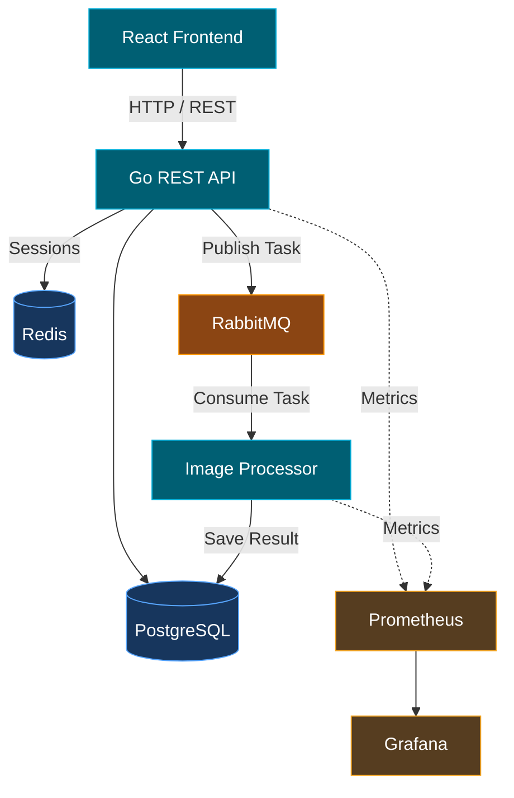

<!-- ==================== HEADER ==================== -->

<div align="center">


<a href="https://github.com/Daisy32411">
  
</a>

<br>

<a href="https://t.me/al0trop">
  
</a>
<a href="mailto:kamilazatovich12@gmail.com">
  
</a>
<a href="https://github.com/Daisy32411">
  
</a>

<br><br>


</div>

<!-- ==================== ABOUT ME ==================== -->

## 🧑‍💻 01 / About Me


Начинающий **Go Backend Developer**. Обучаюсь в Школе 21 от Сбера с 2025 года.

Разрабатываю backend-сервисы, изучаю микросервисную архитектуру, распределённые системы, базы данных и асинхронную обработку задач.

```go
package main

type Developer struct {
    Name      string
    Role      string
    Education string
    Stack     []string
    Interests []string
}

var me = Developer{
    Name:      "Kamil",
    Role:      "Go Backend Developer",
    Education: "School 21 | Sber",
    Stack: []string{
        "Go", "PostgreSQL", "Redis",
        "RabbitMQ", "Docker", "gRPC",
    },
    Interests: []string{
        "Microservices",
        "Distributed Systems",
        "Backend Architecture",
        "Highload Systems",
    },
}
```

<br clear="both"/>

---

<!-- ==================== TECH STACK ==================== -->

## ⚡ 02 / Tech Stack

<div align="center">

<h3>Programming Languages</h3>


<h3>Databases & Message Brokers</h3>


<h3>Infrastructure & DevOps</h3>


<h3>Monitoring & Observability</h3>


<h3>Frameworks & Build Tools</h3>


<h3>Web Technologies</h3>


<br><br>

<code>REST API</code> · <code>gRPC</code> · <code>Protocol Buffers</code> · <code>JWT</code>

<code>Microservices</code> · <code>CI/CD</code> · <code>Swagger</code> · <code>Make</code>

</div>

---

<!-- ==================== FEATURED PROJECTS ==================== -->

## 🚀 03 / Featured Projects

<div align="center">

<table>
<tr>

<td width="50%" valign="top">

<h3>🖼️ PhotoLab — Photo Editor</h3>

<p>Веб-приложение для асинхронной обработки изображений с разделением на независимые сервисы.</p>

<ul>
<li>REST API и Image Processor</li>
<li>Асинхронная обработка через RabbitMQ</li>
<li>Авторизация и Redis-сессии</li>
<li>Хранение данных в PostgreSQL</li>
<li>Prometheus и Grafana</li>
<li>Swagger, SQL-миграции и CI</li>
</ul>

<p>

</p>

<a href="https://github.com/Daisy32411/photo_editor/tree/hw1">

</a>

</td>

<td width="50%" valign="top">

<h3>🔐 gRPC Auth Service</h3>

<p>Сервис аутентификации и авторизации пользователей на Go с использованием gRPC.</p>

<ul>
<li>gRPC и Protocol Buffers</li>
<li>JWT-токены</li>
<li>Хеширование паролей через bcrypt</li>
<li>Миграции базы данных</li>
<li>Structured logging и graceful shutdown</li>
<li>Автоматический деплой</li>
</ul>

<p>

</p>

<a href="https://github.com/Daisy32411/gRPC">

</a>

</td>
</tr>

<tr>

<td width="50%" valign="top">

<h3>🔗 URL Shortener</h3>

<p>REST API сервис для создания и управления сокращёнными ссылками.</p>

<ul>
<li>HTTP Router на базе go-chi</li>
<li>Авторизация и middleware</li>
<li>SQLite хранилище</li>
<li>Логирование и конфигурация</li>
<li>Автоматический деплой через CI/CD</li>
</ul>

<p>

</p>

<a href="https://github.com/Daisy32411/URL-Shortener">

</a>

</td>

<td width="50%" valign="top">

<h3>🛒 Store REST API</h3>

<p>Backend-сервис интернет-магазина с многослойной архитектурой.</p>

<ul>
<li>Spring Boot и Spring Data JPA</li>
<li>Controller / Service / Repository</li>
<li>CRUD и валидация запросов</li>
<li>DTO и маппинг моделей</li>
<li>PostgreSQL и Swagger</li>
</ul>

<p>

</p>

<a href="https://github.com/Daisy32411/shop">

</a>

</td>
</tr>

<tr>

<td width="50%" valign="top">

<h3>⌨️ Print Simulator</h3>

<p>Веб-тренажёр слепой печати, ориентированный на программистов.</p>

<ul>
<li>Backend на Go</li>
<li>Фрагменты реального исходного кода</li>
<li>Подсветка синтаксиса</li>
<li>Статистика в реальном времени</li>
<li>Кастомное структурированное логирование</li>
</ul>

<p>

</p>

<a href="https://github.com/Daisy32411/print-simulator">

</a>

</td>

<td width="50%" valign="top">

<h3>🗄️ Pharmacy Database</h3>

<p>Реляционная база данных для управления аптечными операциями.</p>

<ul>
<li>Управление товарами и поставщиками</li>
<li>Учёт продаж и остатков</li>
<li>Автоматическое обновление запасов</li>
<li>Ограничения целостности данных</li>
<li>Аналитические представления</li>
</ul>

<p>

</p>

<a href="https://github.com/Daisy32411/DataBase-Pharmacy">

</a>

</td>
</tr>
</table>

</div>

---

<!-- ==================== ARCHITECTURE ==================== -->

## 🏗️ 04 / Architecture Showcase

<details open>
<summary><b>PhotoLab — Distributed Image Processing</b></summary>

<br>

Упрощённая архитектура приложения для асинхронной обработки изображений.



**Architecture highlights**

- Разделение ответственности между сервисами.
- Асинхронное взаимодействие через брокер сообщений.
- Хранение пользовательских сессий в Redis.
- Мониторинг и сбор метрик.
- Контейнеризация компонентов приложения.

</details>

---

<!-- ==================== SYSTEM PROGRAMMING ==================== -->

## ⚙️ 05 / System Programming

<details open>
<summary><b>C / Low-Level Development / Algorithms</b></summary>

<br>

<div align="center">


</div>

<br>

| Project | Description | Technologies |
|:---|:---|:---|
| **[KILO](https://github.com/Daisy32411/TextEditor)** | Минималистичный терминальный текстовый редактор. Raw-режим терминала, сохранение файлов, поиск по тексту и навигация. | `C` `Make` `Linux` |
| **[string+](https://github.com/Daisy32411/string-)** | Собственная реализация библиотеки string.h с дополнительными функциями обработки строк. Покрытие тестами более 80%. | `C` `Check` `gcov` `CI` |
| **[Decimal](https://github.com/Daisy32411/Decimal)** | Библиотека точных десятичных вычислений. 96-битное представление чисел, арифметика, сравнение, конвертация и округление. Покрытие тестами более 80%. | `C` `Check` `gcov` `CI` |
| **[Matrix](https://github.com/Daisy32411/matrix)** | Библиотека матричных вычислений: арифметика, транспонирование, определитель, обратная матрица. Покрытие тестами более 80%. | `C` `Check` `gcov` `CI` |

</details>

---

<!-- ==================== GITHUB STATISTICS ==================== -->

## 📊 06 / GitHub Analytics

<div align="center">


<br><br>


</div>

### 📈 Contribution Activity

<div align="center">


</div>

---

<!-- ==================== CONTACTS ==================== -->

## 📫 07 / Connect With Me

<div align="center">

<p>Открыт к новым проектам, сотрудничеству и профессиональному развитию.</p>

<a href="https://t.me/al0trop">

</a>

<a href="mailto:kamilazatovich12@gmail.com">

</a>

<a href="https://github.com/Daisy32411">

</a>

<br><br>

<code>while (alive) { learn(); build(); improve(); }</code>

<br><br>


</div>
